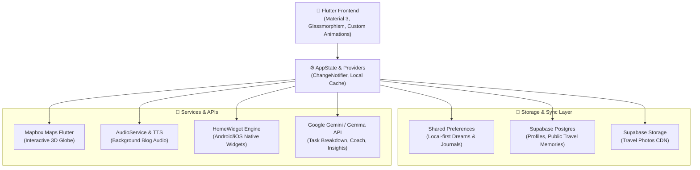

# 🌸 Bloom: The Gamified Life System for Ambitious Women

> *"Changing how ambitious women envision, build, and celebrate their life goals."*

---

## 1. Executive Summary & Vision

Most productivity software was engineered for corporate ticketing, transactional task management, or sterile checklist completion. For ambitious women balancing career milestones, financial autonomy, personal wellness, travel aspirations, and emotional health, generic to-do apps feel disconnected, cold, and punitive. Traditional apps treat growth like unpaid overtime.

**Bloom was built to challenge this paradigm.** 

Bloom is not another checklist; it is an **all-in-one, highly customizable personal growth companion and life system**. Bloom harmonizes vision boarding, financial literacy, travel memories, mindful journaling, and daily habits into a cohesive, gamified ecosystem. As your goals, routines, and adventures evolve, your Bloom space evolves alongside you.

```
       ┌────────────────────────────────────────────────────────┐
       │                🌸 BLOOM LIFE SYSTEM                    │
       └────────────────────────────────────────────────────────┘
                                    │
    ┌─────────────────┬─────────────┴───────────┬────────────────┐
    ▼                 ▼                         ▼                ▼
🌱 Digital Garden   🎯 Vision Boarding        💰 She Stacks   🌍 3D Travel Map
 (Living Habits)     (AI Dream Decomposition)  (11 Arcade Games)(Passport & Memories)
    │                 │                         │                │
    └─────────────────┴─────────────┬───────────┴────────────────┘
                                    ▼
                     📓 AI Journaling & Mood Haven
                      (Empathetic Dialogue & Mindset)
```

---

## 2. The Core Problem vs. The Bloom Solution

| The Traditional Productivity Problem | The Bloom Solution |
| :--- | :--- |
| **Sterile Checklists**: Cold check-boxes that treat life like an endless corporate backlog. | **Living Digital Garden**: Habits nourish a visual 5x5 garden grid. Consistent effort blooms your space; missed days gently slow growth without guilt-tripping streaks. |
| **Fragmented Growth Tools**: Budget apps here, travel pins there, notes scattered everywhere. | **All-In-One Unified Life Hub**: Money, vision, memories, and self-reflection live in one harmonious sanctuary. |
| **Intimidating Financial Advice**: Dense spreadsheets, jargon-filled podcasts, and boring budgeting lectures. | **She Stacks Arcade**: 11 gamified financial mini-games (Wealth Garden, Tax Waterfall, Negotiation Lab) teaching investing, compound interest, and salary negotiation. |
| **Intimidating Blank Diaries**: Traditional journals demand discipline and leave users facing intimidating blank pages. | **AI-Guided Empathy Journal**: An attentive AI companion that reflects on your entries, asks thoughtful questions, and provides daily focus strategy tips. |
| **Privacy Concerns**: Personal dreams and raw reflections uploaded to commercial ad networks. | **Privacy-First Local Storage**: Dream boards and journal reflections stay strictly on your device by default. Only travel memories are shared if you choose. |

---

## 3. Comprehensive Feature Architecture

```mermaid
graph LR
    subgraph Core["🌸 Bloom Core Pillars"]
        DG["🌱 Digital Garden<br/>Visual Habit System"]
        VB["🎯 Vision Board & Dreams<br/>Micro-Goal Breakdown"]
        SS["💰 She Stacks Arcade<br/>11 Financial Mini-Games"]
        TM["🌍 3D World Travel Map<br/>Interactive Passport"]
        JR["📓 AI Journal & Mood<br/>Reflective Guidance"]
    end

    subgraph Sensory["✨ Atmosphere & Experience"]
        WM["❄️ Winter Mode<br/>Physics Snow Overlay"]
        TTS["🎧 Audio Podcasts<br/>Hands-free Listening"]
        WID["📱 Native Widgets<br/>Home Screen Actions"]
        CUST["🎨 Deep Customization<br/>Colors & Typography"]
    end

    Core --> Sensory
```



### 3.1 🌱 Digital Garden (Living Gamification)
Instead of unforgiving numeric streaks that cause anxiety and demotivation after a single missed day, Bloom introduces a **living, visual garden**:
* **Visual Habit Feedback**: Each day you complete your daily rituals and check-ins, your digital garden is watered, causing colorful flowers, plants, and foliage to flourish across an interactive 5x5 grid.
* **Resilient Progression**: If life gets busy and you miss a day, growth gently slows down rather than resetting your entire progress to zero.
* **Sense of Tangible Accomplishment**: Users can visually observe weeks of consistency transformed into a vibrant sanctuary.

---

### 3.2 🎯 Vision Boarding & Dreams
Ambitious goals often stall because the gap between today and tomorrow feels insurmountable. Bloom transforms abstract aspirations into reality:
* **Rich Visual Vision Boards**: Create unlimited dreams with custom color accents, motivational cover imagery, and target deadlines.
* **AI-Powered Micro-Goal Decomposition**: With a single tap, Bloom’s AI takes a big dream (e.g., *"Publish my first novel in 6 months"*) and deconstructs it into a 7-day schedule of bite-sized micro-steps that take **less than 20 minutes** each.
* **The 2-Minute Momentum Rule**: Bypasses goal paralysis by helping women take effortless first steps.

---

### 3.3 💰 She Stacks Arcade (11 Financial Mini-Games)
Financial independence is the foundation of female empowerment. She Stacks replaces dry spreadsheets with interactive micro-simulations:

1. **Wealth Garden**: Visualizes the magic of compound growth and regular investing over 10, 20, and 30-year horizons.
2. **Money Flow**: Teaches the 50/30/20 budgeting philosophy through an intuitive flow mechanics game.
3. **Tax Waterfall**: De-mystifies progressive tax brackets and deductions so users know exactly how their earnings work.
4. **Negotiation Lab**: An interactive salary negotiation simulator powered by conversational AI acting as a corporate hiring manager, followed by tactical strategy tips `[Tip: ...]` on anchoring and ROI.
5. **Longevity Fund**: Explores retirement security, life expectancy variances, and long-term healthcare planning for women.
6. **Mindset Mirror**: Interactive prompts addressing money trauma, scarcity mindset, and imposter syndrome.
7. **Founder Finance**: Simulates equity splits, burn rates, runway, and cash flow for aspiring female founders.
8. **Inflation Trip**: Teaches purchasing power erosion over time and why cash in savings accounts loses real value.
9. **Safety Shield**: Gamifies building an emergency fund of 3–6 months' living expenses.
10. **Gap Visualizer**: Illustrates the lifetime wealth impact of the gender wage and investment gaps.
11. **She Venture**: Venture capital and angel investment simulations tailored for female angel syndicates.

---

### 3.4 📚 Curated Reads & Audiobook Player
* **Tailored Micro-Articles**: Short, impactful 3-minute reads focused on productivity, financial confidence, career pivots, and emotional resilience.
* **Integrated Audio Player**: Fully integrated with `audio_service`, `audio_session`, and native background audio controls.
* **Listen Anywhere**: Turn any curated article into an audiobook on the go—during morning walks, workouts, or quiet commutes. Includes scrubber progress, lock-screen notifications, and speed controls.

---

### 3.5 🌍 Interactive 3D World Map & Travel Memories
* **Interactive 3D Globe**: Powered by Mapbox vector tiles and globe projections, allowing users to spin, zoom, and pinpoint destinations.
* **Digital Passport Stamps**: Automatically earns commemorative digital stamps as you log travels across continents and countries.
* **Photo Journaling**: Upload high-resolution trip photography directly to cloud storage, associated with specific geo-coordinates and journal entries.
* **Community Inspiration Feed**: A safe, curated public stream where travelers can opt-in to share itineraries and inspire fellow women travelers around the globe.

---

### 3.6 📓 AI Journaling & Mood Haven
* **Private Reflection Space**: Log morning intentions, evening gratitudes, and open-ended stream of consciousness.
* **Mood Tracking**: Associative emoji mood tracking that correlates emotional states with habit completion and garden vibrancy.
* **Conversational AI Companion**: Rather than a cold empty note, tap **Discuss with AI** to engage in a supportive, two-way therapeutic check-in. The AI provides empathetic reflections, reframes negative thoughts, and offers constructive encouragement.

---

### 3.7 📱 Native Home Screen Widgets
Stay tethered to your aspirations without opening the application:
* **Interactive To-Do List Widget**: View and cross off your daily rituals right from your Android or iOS home screen.
* **Travel Map Widget**: Displays your latest adventure pin and stats at a glance.
* Built using `home_widget` to ensure instant, background synchronization with your in-app state.

---

### 3.8 🎨 Atmosphere, Sensory Design & Deep Customization
Bloom is built on the philosophy that a digital workspace should feel soothing, warm, and personal:
* **Curated Palette**: Coral oranges, soft rose, lavender hues, sage greens, and dark mode aesthetics tailored with subtle glassmorphism.
* **Winter Mode ❄️**: A delightful physics-based interactive snow overlay that cascades snowflakes across the screen, turning the app into a cozy winter sanctuary.
* **Dynamic Typography & Accessibility**: User-controlled font scaling from `0.8x` to `1.3x` to guarantee effortless readability for all eyes.

---

### 3.9 🔐 Privacy-First by Design
* **Local-First Storage**: Your dream visions, vulnerable thoughts, and daily journal entries are saved locally on your device by default.
* **No Unsolicited Cloud Uploads**: Personal data stays private.
* **Opt-In Sharing**: Only travel pins that you explicitly mark as **Public** are synced to the community travel feed.

---

## 4. Technical Architecture & Technology Stack



---

## 5. Engineering Challenges Overcome

1. **Two-Way Home Screen Widget Synchronization**:
   * *Challenge*: Ensuring widgets reflect task completions immediately without draining battery or requiring cold app boots.
   * *Solution*: Leveraged `home_widget` background broadcast receivers with lightweight JSON serialization directly to shared storage.

2. **3D Mapbox Memory Footprint on Mobile**:
   * *Challenge*: Mapbox globe rendering consumes heavy GPU and RAM resources, risking stutter during tab switches.
   * *Solution*: Implemented custom lifecycle hooks to freeze rendering and dispose annotation managers when switching to Dreams or Journaling tabs.

3. **Offline-First Data Reconciliation**:
   * *Challenge*: Enabling women to journal on flights or in remote travel spots without internet, then seamlessly syncing with cloud storage once reconnected.
   * *Solution*: Hybrid storage engine in `StorageService` where all models write locally first to `SharedPreferences`, queuing cloud sync operations asynchronously.

---

## 6. Key Learnings & Product Insights

* **Financial Empathy in UX**: Women don't avoid financial planning due to a lack of ambition—they avoid it because traditional financial tools speak in adversarial, masculine, and jargon-dense language. Approaching wealth through storytelling and games unlocks engagement.
* **The Delight of Micro-Interactions**: Features like falling snow in Winter Mode, dynamic plant growth, and celebratory confetti upon task completion drove higher day-30 retention than traditional notification spam.
* **Low-Friction Starting**: The 2-minute micro-action philosophy breaks down overwhelming long-term dreams into easy, achievable everyday wins.

---

## 7. What's Next for Bloom (Roadmap)

* 🎙️ **Career & Leadership Arcade**:
  * **Public Speaking Simulator**: AI voice feedback on pitch pacing, filler words, and vocal confidence.
  * **Executive Presence & Boundary Setting**: Interactive branching scenarios for negotiating promotions, saying no without guilt, and navigating corporate politics.
* 👥 **Accountability Circles & Pods**:
  * Micro-circles of 3–5 women working on similar dreams (e.g., Marathon Runners, First-time Authors, Startup Founders) sharing encouragement without the toxicity of open social feeds.
* 🌿 **Smart Plant Breeding**:
  * Unlocking unique botanical species in your Digital Garden linked to specific milestones achieved in She Stacks and Dream completions.
