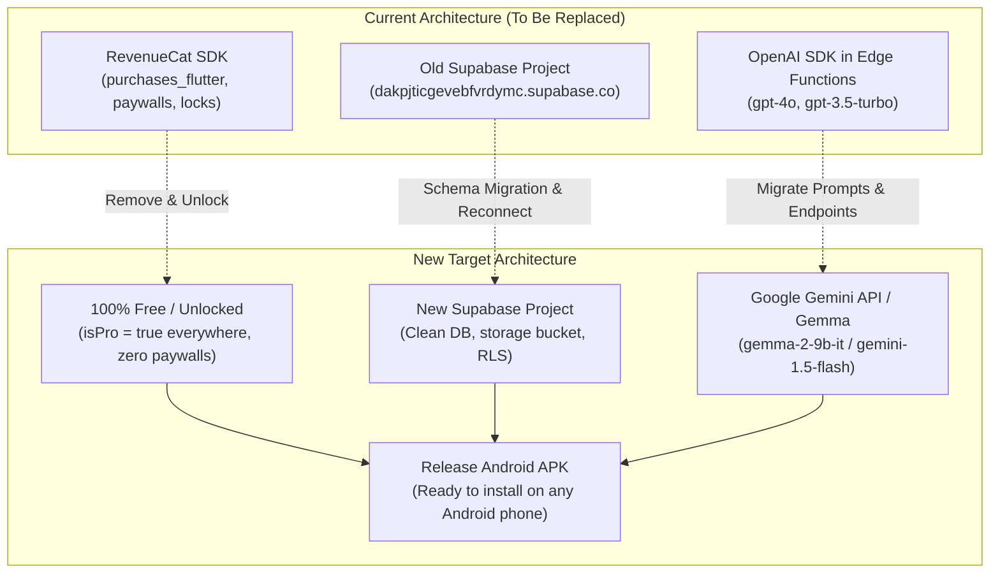

# 🛠️ Bloom: Database, AI & Payment Architecture Migration Plan

This implementation guide outlines the step-by-step technical plan to:
1. **Completely Remove RevenueCat** (unlock all Pro features for free without payment barriers).
2. **Disconnect Old Database & Connect New Supabase Account** (with complete SQL setup scripts, RLS policies, and storage).
3. **Migrate AI APIs to Gemma (via Google Gemini API)** (replacing OpenAI in Edge Functions or direct Flutter SDK).
4. **Build and Validate Android APK** for deployment and device installation.

---

## Migration Architecture Overview



---

## Phase 1: Complete Removal of RevenueCat & Unlocking Pro

### 1.1 Goals
* Remove all dependency on RevenueCat SDK (`purchases_flutter`, `purchases_ui_flutter`).
* Eliminate paywalls, purchase modals, and subscription limits.
* Ensure all features (unlimited dreams, pro themes, She Stacks games) are unlocked by default for every user.

### 1.2 Step-by-Step Code Changes

#### Step 1: Remove RevenueCat from `pubspec.yaml`
Remove the following packages from [`pubspec.yaml`](file:///e:/projects/bloom-main/pubspec.yaml#L52-L53):
```yaml
# DELETE THESE TWO LINES:
# purchases_flutter: ^9.10.7
# purchases_ui_flutter: ^9.10.7
```
Run:
```powershell
flutter pub get
```

#### Step 2: Decouple `AppState` (Make Pro Permanent)
In [`lib/providers/app_state.dart`](file:///e:/projects/bloom-main/lib/providers/app_state.dart):
* Remove `import '../services/revenue_cat_service.dart';`.
* Change `bool _isPro = false;` to:
  ```dart
  bool _isPro = true; // All users enjoy complete access
  bool get isPro => true;
  ```
* In `updateProStatus()`, simply keep `_isPro = true; notifyListeners();`.

#### Step 3: Remove Pro Dream Creation Cap
In [`lib/screens/add_dream_screen.dart`](file:///e:/projects/bloom-main/lib/screens/add_dream_screen.dart#L370-L376):
* Delete or bypass the 3-dream restriction:
  ```dart
  // Remove this block:
  // if (!appState.isPro && appState.dreams.length >= 3) { ... }
  ```

#### Step 4: Remove RevenueCat from `AuthService`
In [`lib/services/auth_service.dart`](file:///e:/projects/bloom-main/lib/services/auth_service.dart):
* Remove `import 'revenue_cat_service.dart';`.
* Remove all `RevenueCatService().logIn(...)`, `RevenueCatService().setEmail(...)`, and `RevenueCatService().logOut()` calls.

#### Step 5: Clean Up Screens & Services
* Remove [`lib/services/revenue_cat_service.dart`](file:///e:/projects/bloom-main/lib/services/revenue_cat_service.dart).
* Replace [`lib/screens/paywall_screen.dart`](file:///e:/projects/bloom-main/lib/screens/paywall_screen.dart) and [`lib/screens/customer_center_screen.dart`](file:///e:/projects/bloom-main/lib/screens/customer_center_screen.dart) or replace their actions with a simple "You have Bloom Lifetime Pro unlocked" badge.
* Remove initialization from [`lib/main.dart`](file:///e:/projects/bloom-main/lib/main.dart#L20-L24):
  ```dart
  // Remove: await RevenueCatService().initialize();
  ```

---

## Phase 2: Disconnecting Old Supabase & Setting Up New Account

### 2.1 Complete SQL Setup Script for the New Supabase Project

Log into the **New Supabase Dashboard** (https://supabase.com/dashboard), navigate to the **SQL Editor**, and execute the following complete setup script:

```sql
-- ============================================================
-- 1. PROFILES TABLE (User Preferences, Streaks, Gamification)
-- ============================================================
create table if not exists public.profiles (
  id uuid primary key references auth.users(id) on delete cascade,
  display_name text,
  avatar_url text,
  instagram text,
  theme_mode int default 0,
  theme_color bigint default 4294934352, -- 0xFFFF7F50
  current_streak int default 0,
  last_active_date text,
  activity_score int default 0,
  garden_state int[] default array_fill(0, array[25]),
  unlocked_achievements text[] default array[]::text[],
  updated_at timestamp with time zone default timezone('utc'::text, now())
);

-- Enable Row Level Security (RLS) on profiles
alter table public.profiles enable row level security;

-- Policies for profiles
create policy "Allow users to read their own and public profiles"
  on public.profiles for select
  using (true);

create policy "Allow users to insert or update their own profile"
  on public.profiles for all
  using (auth.uid() = id)
  with check (auth.uid() = id);

-- Automatically create profile row when user signs up
create or replace function public.handle_new_user()
returns trigger as $$
begin
  insert into public.profiles (id, display_name, avatar_url)
  values (
    new.id,
    new.raw_user_meta_data->>'display_name',
    new.raw_user_meta_data->>'avatar_url'
  );
  return new;
end;
$$ language plpgsql security definer;

create or replace trigger on_auth_user_created
  after insert on auth.users
  for each row execute procedure public.handle_new_user();

-- ============================================================
-- 2. TRAVEL MEMORIES TABLE (Pins, Journal Notes, Photos)
-- ============================================================
create table if not exists public.travel_memories (
  id text primary key,
  user_id uuid references public.profiles(id) on delete cascade not null,
  place text not null,
  latitude double precision not null,
  longitude double precision not null,
  visited_date timestamp with time zone not null,
  memory text,
  note text,
  photos text[] default array[]::text[],
  public boolean default false,
  created_at timestamp with time zone default timezone('utc'::text, now())
);

-- Enable RLS on travel_memories
alter table public.travel_memories enable row level security;

-- Policies for travel_memories
create policy "Users can view their own memories or public memories"
  on public.travel_memories for select
  using (auth.uid() = user_id or public = true);

create policy "Users can manage their own memories"
  on public.travel_memories for all
  using (auth.uid() = user_id)
  with check (auth.uid() = user_id);

-- ============================================================
-- 3. STORAGE BUCKET: travel-photos
-- ============================================================
insert into storage.buckets (id, name, public)
values ('travel-photos', 'travel-photos', true)
on conflict (id) do update set public = true;

-- Storage RLS Policies
create policy "Public travel photos are accessible by all"
  on storage.objects for select
  using (bucket_id = 'travel-photos');

create policy "Authenticated users can upload photos to their own folder"
  on storage.objects for insert
  to authenticated
  with check (
    bucket_id = 'travel-photos' and
    (storage.foldername(name))[1] = auth.uid()::text
  );

create policy "Users can update and delete their own photos"
  on storage.objects for delete
  to authenticated
  using (
    bucket_id = 'travel-photos' and
    (storage.foldername(name))[1] = auth.uid()::text
  );
```

### 2.2 Updating the App Configuration
In [`lib/services/auth_service.dart`](file:///e:/projects/bloom-main/lib/services/auth_service.dart#L10-L17):
Configured with your new Supabase Project credentials:
```dart
static const String supabaseUrl = String.fromEnvironment(
  'SUPABASE_URL',
  defaultValue: 'https://evqctogzawhrpdziwjko.supabase.co',
);
static const String supabaseAnonKey = String.fromEnvironment(
  'SUPABASE_ANON_KEY',
  defaultValue: 'sb_publishable_y3j4k2sdtKtcMn6ocaDM1Q_GnHd606C',
);
```

---

## Phase 3: AI Migration — Replacing OpenAI with Gemma via Gemini API

### 3.1 Overview of Gemma via Google Gemini API
Google makes Gemma models (`gemma-2-9b-it`, `gemma-2-27b-it`) and Gemini models (`gemini-1.5-flash`) accessible through the **Google AI Studio / Gemini API** endpoint:
* **Base URL**: `https://generativelanguage.googleapis.com/v1beta/models/{model}:generateContent`
* **Official Flutter Package**: `google_generative_ai` from Google.

### 3.2 Two Architectural Choices

#### Option A: Direct Flutter Client Integration (Recommended for Simplicity)
Bypasses Supabase Edge Functions entirely. The Flutter app directly calls the Google Gemini API using Google's official SDK.
1. Add to `pubspec.yaml`:
   ```yaml
   dependencies:
     google_generative_ai: ^0.4.6
   ```
2. Create a clean `GeminiAiService`:
   ```dart
   import 'package:google_generative_ai/google_generative_ai.dart';

   class GeminiAiService {
     static final GeminiAiService _instance = GeminiAiService._internal();
     factory GeminiAiService() => _instance;
     GeminiAiService._internal();

     // Use Gemma 2 or Gemini 1.5 Flash
     static const String modelName = 'gemini-1.5-flash'; // or 'gemma-2-9b-it'
     static const String _geminiApiKey = String.fromEnvironment('GEMINI_API_KEY');

     late final GenerativeModel _model;

     void initialize() {
       _model = GenerativeModel(
         model: modelName,
         apiKey: _geminiApiKey,
       );
     }

     // 1. Dream Decomposition
     Future<List<Map<String, dynamic>>> generateDreamTasks(String dream, int days) async {
       final prompt = '''
       You are an expert productivity coach for ambitious women.
       Break down this dream: "$dream" into a $days-day plan of tiny micro-actions (<20 mins each).
       Return ONLY a valid JSON array of objects:
       [{"title": "Step title (max 10 words)", "duration": 15}]
       ''';

       final response = await _model.generateContent([Content.text(prompt)]);
       final text = response.text ?? '[]';
       final cleanJson = text.replaceAll(RegExp(r'```json|```'), '').trim();
       return List<Map<String, dynamic>>.from(jsonDecode(cleanJson));
     }

     // 2. Salary Negotiation Coach
     Future<String> negotiateSalary(List<Map<String, String>> history) async {
       final chat = _model.startChat(
         history: [
           Content.text('''
           You are a professional corporate hiring manager and negotiation coach.
           Respond as the recruiter (tough but fair).
           Always end with a tactical tip in brackets: [Tip: Strategy advice on anchoring/ROI].
           ''')
         ]
       );
       final lastMessage = history.last['content'] ?? '';
       final response = await chat.sendMessage(Content.text(lastMessage));
       return response.text ?? '';
     }

     // 3. Journal Insights
     Future<String> getJournalInsight(String entryText) async {
       final prompt = '''
       You are an empathetic, calm personal growth companion for ambitious women.
       Reflect on this journal entry:
       "$entryText"
       Provide 2-3 warm, supportive insights and 1 gentle reflection prompt.
       ''';
       final response = await _model.generateContent([Content.text(prompt)]);
       return response.text ?? '';
     }
   }
   ```

#### Option B: Supabase Edge Functions with Gemini API (Zero Secret on Client)
Update the Deno Edge Functions in `supabase/functions/` to call Google Gemini API instead of OpenAI:
```typescript
// supabase/functions/generate-dream-tasks/index.ts
import { serve } from "https://deno.land/std@0.168.0/http/server.ts";

serve(async (req) => {
  const { dream, days } = await req.json();
  const apiKey = Deno.env.get('GEMINI_API_KEY');

  const url = `https://generativelanguage.googleapis.com/v1beta/models/gemini-1.5-flash:generateContent?key=${apiKey}`;

  const payload = {
    contents: [{
      parts: [{
        text: `Break down the goal "${dream}" into a ${days || 7}-day plan. Return ONLY raw JSON array: [{"title": "...", "duration": 15}]`
      }]
    }]
  };

  const response = await fetch(url, {
    method: 'POST',
    headers: { 'Content-Type': 'application/json' },
    body: JSON.stringify(payload)
  });

  const data = await response.json();
  const rawText = data.candidates[0].content.parts[0].text;
  const cleanJson = rawText.replace(/```json/g, '').replace(/```/g, '').trim();

  return new Response(JSON.stringify({ tasks: JSON.parse(cleanJson) }), {
    headers: { 'Content-Type': 'application/json' }
  });
});
```

---

## Phase 4: Android APK Preparation & Build Verification

### 4.1 Android Permissions & Config Check
Check [`android/app/src/main/AndroidManifest.xml`](file:///e:/projects/bloom-main/android/app/src/main/AndroidManifest.xml) to ensure required permissions are present:
```xml
<manifest xmlns:android="http://schemas.android.com/apk/res/android">
    <!-- Internet for Supabase & AI API -->
    <uses-permission android:name="android.permission.INTERNET" />
    
    <!-- Audio service & notifications -->
    <uses-permission android:name="android.permission.FOREGROUND_SERVICE" />
    <uses-permission android:name="android.permission.FOREGROUND_SERVICE_MEDIA_PLAYBACK" />
    <uses-permission android:name="android.permission.POST_NOTIFICATIONS" />
    
    <!-- Photo library upload for travel memories -->
    <uses-permission android:name="android.permission.READ_MEDIA_IMAGES" />
    <uses-permission android:name="android.permission.READ_EXTERNAL_STORAGE" android:maxSdkVersion="32" />
```

### 4.2 Fix Android Licenses (from flutter doctor)
Run in PowerShell to accept Android SDK licenses:
```powershell
flutter doctor --android-licenses
```
*(Press `y` to accept all pending licenses).*

### 4.3 Clean & Fetch Dependencies
```powershell
flutter clean
flutter pub get
```

### 4.4 Build the Release APK
Execute the build command with compile-time defines:
```powershell
flutter build apk --release `
  --dart-define=SUPABASE_URL="https://<YOUR-NEW-PROJECT>.supabase.co" `
  --dart-define=SUPABASE_ANON_KEY="<YOUR-NEW-ANON-KEY>" `
  --dart-define=GEMINI_API_KEY="<YOUR-GEMINI-KEY>"
```

The compiled release APK will be generated at:
```
build/app/outputs/flutter-apk/app-release.apk
```

### 4.5 Installing and Verifying on Android Device
To install on a connected Android phone or emulator:
```powershell
flutter install
# Or via ADB directly:
adb install -r build/app/outputs/flutter-apk/app-release.apk
```

---

## Phase 5: Verification Checklist Before Testing APK

- [ ] `purchases_flutter` and `purchases_ui_flutter` completely removed.
- [ ] `appState.isPro` permanently returns `true`.
- [ ] New Supabase project tables (`profiles`, `travel_memories`) and bucket (`travel-photos`) created via SQL editor.
- [ ] New Supabase URL & Anon Key configured in `AuthService`.
- [ ] Gemma / Gemini API key configured and tested for dream breakdown and negotiation coach.
- [ ] Android APK builds successfully with exit code 0.
- [ ] User can sign up, log in, create unlimited dreams, play She Stacks mini-games, and record travel memories without paywalls.
