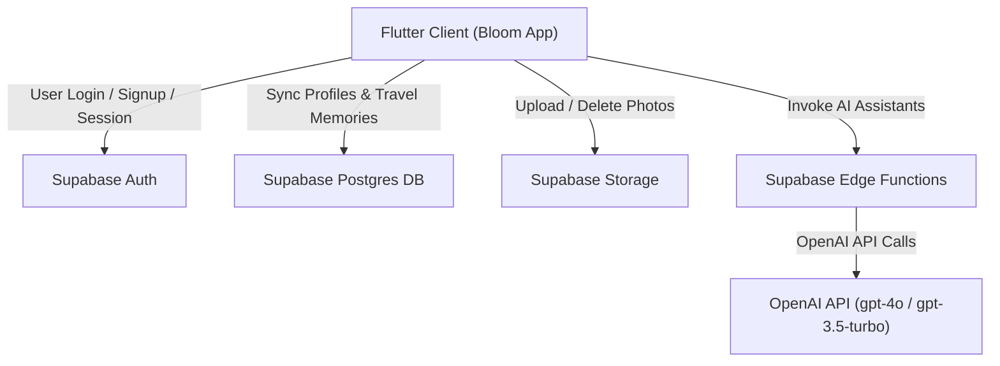

# Bloom Project Audit: RevenueCat, Secrets Architecture, Supabase & AI Services

This document provides a technical audit of the **Bloom** Flutter application, covering:
1. **RevenueCat Secrets and Configuration**
2. **Environment Secrets Embedding & Security Architecture**
3. **Supabase Functions and Features**
4. **AI APIs & Machine Learning Services**

---

## 1. RevenueCat Secrets & Configuration

### 1.1 Exposed Keys and Identifiers
The RevenueCat API keys and entitlement IDs are defined in [`lib/services/revenue_cat_service.dart`](file:///e:/projects/bloom-main/lib/services/revenue_cat_service.dart#L13-L15):

| Item | Value | Type / Notes |
| :--- | :--- | :--- |
| **iOS API Key** | `test_...[REDACTED]` | RevenueCat Sandbox/Test Public SDK Key |
| **Android API Key** | `goog_...[REDACTED]` | RevenueCat Google Play Public SDK Key |
| **Entitlement Identifier** | `bloom_pro` | RevenueCat Entitlement ID granting Pro features |

> [!NOTE]
> RevenueCat SDK keys (`goog_...` and `appl_...` or `test_...`) are **public API keys** designed to be embedded in client-side mobile applications. While they do not grant admin access to the RevenueCat dashboard, having them hardcoded directly in source control exposes project configuration and prevents environment-specific builds (e.g., separating staging and production).

---

### 1.2 RevenueCat Implementation & Flow

The RevenueCat integration is handled via the singleton service [`RevenueCatService`](file:///e:/projects/bloom-main/lib/services/revenue_cat_service.dart):

* **Initialization (`RevenueCatService().initialize()`):**
  * Invoked at app launch in [`lib/main.dart`](file:///e:/projects/bloom-main/lib/main.dart#L21).
  * Selects key dynamically based on `Platform.isIOS` or `Platform.isAndroid`.
  * Configures `PurchasesConfiguration(apiKey)..appUserID = null` (initializes with an anonymous ID until user logs in).
  * Enables debug logging in debug mode (`LogLevel.debug`).
  * Attaches a listener `Purchases.addCustomerInfoUpdateListener` to broadcast live subscription updates.

* **Identity Syncing with Supabase:**
  * When a user signs up or logs into Supabase in [`lib/services/auth_service.dart`](file:///e:/projects/bloom-main/lib/services/auth_service.dart#L28-L31):
    * `Purchases.logIn(currentUser.id)` maps the RevenueCat user ID to the Supabase Auth UID.
    * `Purchases.setEmail(currentUser.email)` attaches the user's email to RevenueCat customer data.
  * When the user signs out (`AuthService().signOut()`), `Purchases.logOut()` resets back to an anonymous ID.

* **Strict Pro Access Verification (`hasProAccess()`):**
  * Located at [`RevenueCatService.hasProAccess()`](file:///e:/projects/bloom-main/lib/services/revenue_cat_service.dart#L114-L136).
  * Validates that:
    1. The `bloom_pro` entitlement exists and is active (`isActive == true`).
    2. The RevenueCat `originalAppUserId` strictly matches the active `Purchases.appUserID` (Supabase UID) to prevent unauthorized entitlement leakage across accounts.

* **Paywall & Customer Center UI:**
  * Uses the official `purchases_ui_flutter` package.
  * [`PaywallScreen`](file:///e:/projects/bloom-main/lib/screens/paywall_screen.dart): Uses `PaywallView` with callbacks for `onPurchaseCompleted`, `onRestoreCompleted`, and `onDismiss`.
  * [`CustomerCenterScreen`](file:///e:/projects/bloom-main/lib/screens/customer_center_screen.dart): Uses `CustomerCenterView` to allow users to view current plan status, renewal dates, cancel subscriptions, or restore purchases via `Purchases.restorePurchases()`.

---

## 2. Environment Secrets Architecture: How Secrets are Embedded

### 2.1 Current Implementation: Direct Client Hardcoding
In the current project state, **secrets and configuration are hardcoded directly into Dart source code**:

* **RevenueCat Keys**: Hardcoded in [`lib/services/revenue_cat_service.dart`](file:///e:/projects/bloom-main/lib/services/revenue_cat_service.dart#L13-L14).
* **Supabase URL & Anon Key**: Configured via environment variables in [`lib/services/auth_service.dart`](file:///e:/projects/bloom-main/lib/services/auth_service.dart):
  * **URL**: `https://dakpjticgevebfvrdymc.supabase.co`
  * **Anon Key**: `[REDACTED_JWT_ANON_KEY]`
* **Mapbox Public Access Token**: Configured via environment variable:
  * **Token**: `pk.eyJ...[REDACTED]`

> [!WARNING]
> **No `.env` or `--dart-define` is currently configured:**
> - There are **no `.env` files** in the repository.
> - The `.gitignore` does **not** contain `.env`.
> - `pubspec.yaml` does not include `flutter_dotenv` or `flutter_config`.
> - No `String.fromEnvironment()` or `bool.fromEnvironment()` compile-time flags are used in the Dart codebase.

---

### 2.2 Server-Side Secrets Embedding (Supabase Edge Functions)
In contrast to the Flutter client, server-side Edge Functions securely load sensitive private secrets from runtime environment variables:

* **OpenAI API Key**:
  * Loaded in [`supabase/functions/generate-dream-tasks/index.ts`](file:///e:/projects/bloom-main/supabase/functions/generate-dream-tasks/index.ts#L25) and [`supabase/functions/negotiation-coach/index.ts`](file:///e:/projects/bloom-main/supabase/functions/negotiation-coach/index.ts#L16):
    ```typescript
    const apiKey = Deno.env.get('OPENAI_API_KEY');
    if (!apiKey) throw new Error('OPENAI_API_KEY is not set');
    ```
  * Managed via Supabase Vault / Secrets CLI (`supabase secrets set OPENAI_API_KEY=sk-...`).
  * The OpenAI secret is **never shipped to or exposed in the mobile client**.

---

### 2.3 Recommended Refactoring for Environment Secrets
To follow production security best practices:

1. **Option A: Flutter `--dart-define` (Zero-dependency, Built into Flutter)**
   ```dart
   static const String supabaseUrl = String.fromEnvironment('SUPABASE_URL');
   static const String supabaseAnonKey = String.fromEnvironment('SUPABASE_ANON_KEY');
   static const String rcIosKey = String.fromEnvironment('RC_IOS_KEY');
   static const String rcAndroidKey = String.fromEnvironment('RC_ANDROID_KEY');
   static const String mapboxToken = String.fromEnvironment('MAPBOX_ACCESS_TOKEN');
   ```
   Run/build with:
   ```bash
   flutter run --dart-define=SUPABASE_URL=https://... --dart-define=SUPABASE_ANON_KEY=...
   ```
   Or use a `config.json` via `--dart-define-from-file=config.json` (with `config.json` added to `.gitignore`).

2. **Option B: `flutter_dotenv`**
   Add `flutter_dotenv` to `pubspec.yaml`, create `.env`, add `.env` to `.gitignore`, and initialize in `main.dart` with `await dotenv.load(fileName: ".env");`.

---

## 3. Supabase Functions & Features Used in the Project

The application connects to project **`dakpjticgevebfvrdymc.supabase.co`** using `supabase_flutter: ^2.12.0`. The project leverages 4 core pillars of Supabase:



---

### 3.1 Supabase Authentication (`Supabase.instance.client.auth`)

Found in [`lib/services/auth_service.dart`](file:///e:/projects/bloom-main/lib/services/auth_service.dart) and throughout the app:

| Supabase Auth Method | Purpose & Usage in Code |
| :--- | :--- |
| `Supabase.initialize(url, anonKey)` | Initializes the client singleton at startup in `main.dart`. |
| `_supabase.auth.currentUser` | Returns the currently authenticated user (`User?`), used across `AppState`, `StorageService`, and `PassportBottomSheet`. |
| `_supabase.auth.currentSession` | Retrieves the active user session and expiration token (`session?.expiresAt`). |
| `_supabase.auth.onAuthStateChange` | Real-time reactive stream consumed by `AuthWrapper`, `HomeScreen`, and `HomeTabScreen` to switch between authenticated UI and `AuthGatewayScreen`. |
| `_supabase.auth.signUp(...)` | Creates a new account with email, password, and custom metadata (`display_name`). |
| `_supabase.auth.signInWithPassword(...)`| Authenticates returning users with email and password. |
| `_supabase.auth.signOut()` | Logs out the user and disconnects the RevenueCat customer session. |
| `_supabase.auth.updateUser(...)` | Updates user metadata (`display_name`, `avatar_url`) via `UserAttributes(data: updates)`. |
| `_supabase.auth.refreshSession()` | Refreshes JWT tokens upon metadata update or when handling HTTP 401 exceptions from Edge Functions. |

---

### 3.2 Supabase Database (`Supabase.instance.client.from(...)`)

Found in [`lib/services/storage_service.dart`](file:///e:/projects/bloom-main/lib/services/storage_service.dart):

#### Table: `profiles`
Stores user profile information, gamification, and settings:
* **`upsert()` operations:**
  * **Theme & UI Preferences**: Saves `theme_mode`, `theme_color`, `instagram`, `display_name`, `avatar_url`.
  * **Streak Tracking**: Syncs `current_streak` and `last_active_date`.
  * **Gamification & Garden**: Syncs `activity_score`, `unlocked_achievements` array, and the 5x5 `garden_state` array.
* **`select()` operations:**
  * `from('profiles').select().eq('id', user.id).single()`: Loads full cloud profile for settings sync.
  * `from('profiles').select().eq('id', userId).single()`: Loads other users' profiles for social/community displays.

#### Table: `travel_memories`
Stores user travel pinpoints, memories, and photo galleries:
* **`upsert()` operations:**
  * Syncs list of travel memories with fields: `id`, `user_id`, `place`, `latitude`, `longitude`, `visited_date`, `memory`, `note`, `photos` (array of URLs), and `public` (boolean flag).
* **`select()` operations:**
  * **User's Private Memories**: `from('travel_memories').select().eq('user_id', user.id).order('visited_date')`.
  * **Community Public Feed**:
    * Attempted relational query: `from('travel_memories').select('*, profiles(display_name, avatar_url)').eq('public', true).order('visited_date', ascending: false).limit(100)`
    * Graceful fallback query if foreign key join fails: `from('travel_memories').select('*').eq('public', true)...`
* **`delete()` operations:**
  * `from('travel_memories').delete().eq('id', id)`: Deletes memory record when user removes a pin.

---

### 3.3 Supabase Storage (`Supabase.instance.client.storage`)

Found in [`lib/services/storage_service.dart`](file:///e:/projects/bloom-main/lib/services/storage_service.dart#L49-L70):

* **Bucket Name:** `travel-photos`
* **Features Used:**
  * `_supabase.storage.from('travel-photos').upload(path, file, fileOptions: FileOptions(upsert: true))`:
    * Uploads local image files using the storage path convention: `${user.id}/${fileName}`.
  * `_supabase.storage.from('travel-photos').getPublicUrl(path)`:
    * Converts the uploaded storage path into a publicly accessible CDN image URL stored in the database.
  * `_supabase.storage.from('travel-photos').remove(pathsToDelete)`:
    * Cleans up and deletes image assets from Supabase Storage when a travel memory is deleted.

---

### 3.4 Supabase Edge Functions (`Supabase.instance.client.functions.invoke(...)`)

Edge Functions act as a secure gateway for executing AI tasks without exposing API keys to the client.

* **Client Invocation:**
  * The Flutter app invokes edge functions with:
    ```dart
    final response = await Supabase.instance.client.functions.invoke(
      '<function-name>',
      body: { ... },
    );
    ```
  * In [`lib/widgets/she_stacks/negotiation_lab.dart`](file:///e:/projects/bloom-main/lib/widgets/she_stacks/negotiation_lab.dart#L143-L163), an automatic **HTTP 401 retry policy** is implemented: if a token has expired, it calls `supabase.auth.refreshSession()` and re-invokes the function.

---

## 4. AI APIs Used in the Project

The project integrates AI primarily through **OpenAI** proxied via Supabase Edge Functions, alongside local speech synthesis:

| AI Feature | Model | Provider / Execution | File Location | Purpose |
| :--- | :--- | :--- | :--- | :--- |
| **Dream Task Breakdown** | `gpt-4o` | OpenAI via Supabase Edge Function (`generate-dream-tasks`) | [`supabase/functions/generate-dream-tasks/index.ts`](file:///e:/projects/bloom-main/supabase/functions/generate-dream-tasks/index.ts) | Breaks high-level user dreams into a 7-day plan of micro-steps (<20 mins). |
| **Salary Negotiation Coach** | `gpt-3.5-turbo` | OpenAI via Supabase Edge Function (`negotiation-coach`) | [`supabase/functions/negotiation-coach/index.ts`](file:///e:/projects/bloom-main/supabase/functions/negotiation-coach/index.ts) | Roleplays as a hiring recruiter and provides actionable negotiation strategy tips. |
| **Journal Insight & Discussion** | OpenAI (Deployed on Cloud) | OpenAI via Supabase Edge Function (`journal-insight`) | [`lib/screens/journal_screen.dart`](file:///e:/projects/bloom-main/lib/screens/journal_screen.dart#L1204), [`lib/screens/journal_ai_discussion_screen.dart`](file:///e:/projects/bloom-main/lib/screens/journal_ai_discussion_screen.dart#L68), [`lib/screens/home_screen.dart`](file:///e:/projects/bloom-main/lib/screens/home_screen.dart#L661) | Analyzes thoughts, provides reflection summaries, and powers two-way AI chats on journal entries. |
| **Blog Narration (Speech)** | Local TTS Engine | Device native TTS via `flutter_tts` | [`lib/providers/app_state.dart`](file:///e:/projects/bloom-main/lib/providers/app_state.dart#L231-L283) | Converts in-app blog articles into audio playback. |

---

### 4.1 Detailed Breakdown of AI Functions

#### A. `generate-dream-tasks` (OpenAI `gpt-4o`)
* **Triggered From:** [`lib/screens/add_dream_screen.dart`](file:///e:/projects/bloom-main/lib/screens/add_dream_screen.dart#L383)
* **Parameters Sent:**
  * `dream`: Goal description (e.g. "Run a half marathon").
  * `days`: Plan duration (defaults to 7).
* **System Prompt Strategy:**
  * Acts as an expert productivity coach.
  * Enforces tasks under 20 minutes each.
  * Returns a strict, unformatted JSON array of objects:
    ```json
    [
      {"title": "Research best local running trails", "duration": 15},
      {"title": "Buy comfortable running shoes", "duration": 20}
    ]
    ```
* **Client Handling:** Parses the tasks into `ChallengeStep` models and attaches them to the created `Dream`.

---

#### B. `negotiation-coach` (OpenAI `gpt-3.5-turbo`)
* **Triggered From:** [`lib/widgets/she_stacks/negotiation_lab.dart`](file:///e:/projects/bloom-main/lib/widgets/she_stacks/negotiation_lab.dart#L134)
* **Parameters Sent:**
  * `messages`: Full conversation history array with alternating `role` (`user` vs `assistant`) and `content`.
* **System Prompt Strategy:**
  * Roleplays as a corporate hiring manager.
  * Rules:
    1. Respond as a tough but fair recruiter.
    2. Append a tactical tip in brackets `[Tip: ...]` advising on anchoring, ROI, and pivoting.
* **Client Handling:** Extracts the recruiter response and strategy tip, rendering them in a conversational chat bubble UI.

---

#### C. `journal-insight` (Supabase Cloud Function)
Reused across three UI touchpoints:
1. **Journal Screen Reflection (`journal_screen.dart`)**:
   * Analyzes raw journal entries to provide empathetic insights, sentiment summaries, and encouragement.
2. **Interactive Journal Discussion (`journal_ai_discussion_screen.dart`)**:
   * Sends the user's message, journal context (Title + Content), and conversation history with `is_discussion: true`.
   * Allows the user to have an ongoing dialogue about their journal entry.
3. **Daily Focus Strategy Tip (`home_screen.dart`)**:
   * Generates actionable daily mindset tips based on the user's current goals and focus.

---

## 5. Security & Architecture Summary Table

| Category | Item | Current State | Risk / Status | Recommended Action |
| :--- | :--- | :--- | :--- | :--- |
| **RevenueCat** | iOS Test Key | Hardcoded in `revenue_cat_service.dart` | Low (Public SDK key) | Move to `--dart-define` / `.env` before production release. |
| **RevenueCat** | Android Key | Hardcoded in `revenue_cat_service.dart` | Low (Public SDK key) | Move to `--dart-define` / `.env`. |
| **Mapbox** | Public Access Token | Hardcoded in `travel_screen.dart` | Low / Medium (Can be quota abused) | Move to `--dart-define` / `.env`; restrict domains/bundles in Mapbox console. |
| **Supabase** | URL & Anon Key | Hardcoded in `auth_service.dart` | Expected for client (Protected by RLS) | Move to `--dart-define` / `.env`; verify Row Level Security on `profiles` & `travel_memories`. |
| **OpenAI** | API Key | Server-side in Supabase Secrets | **Secure (Best Practice)** | Retain server-side execution via Edge Functions. |
| **Client Secrets** | `.env` file | Absent | Missing standard practice | Implement `.env` or `--dart-define` config pipeline. |
